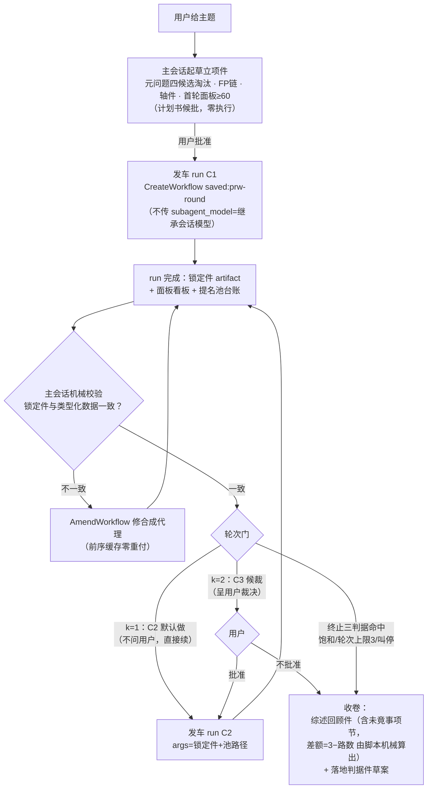
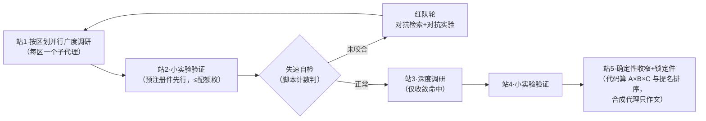

# pre-research-wf · 螺旋四站法工作流版 · 设计规划书（候批，零执行）

> 令源（2026-10-02）：完全新建一个 skill，以本机复杂工作流工具（dynamic workflows：
> CreateWorkflow/AmendWorkflow/GetWorkflowRun 等）为地基，**完全复刻 pre-research v1.2.0
> 的完整流程**（六步总流程 + 四站一锁循环 + 涌现提名 + 未竟事项披露 + 终止三判据）。
> 本件为设计规划书，批准后实施。

## 〇 · 定位与关系

- **法学与工程载体分离**：`pre-research`（v1.2.0）保留为**判据与验收的唯一事实源**（什么算机制条目、什么算小实验、怎么计票、何时收卷）；新技能 `pre-research-wf` 是**执行器**——把这套判据翻译成动态工作流的类型化脚本、确定性门与后台运行。不改原技能一个字。
- **单一事实源的注入方式**：子代理 prompt 一律**传文件路径**不传内容（地基铁律：pass paths, not contents）——ask 里写「读 `~/.zcode/skills/pre-research/references/methodology.md` §1 按模板产出」，子代理用自己的读文件工具取判据。判据升级（如未来 v1.3）零脚本改动自动生效；每轮计划书登记当时技能版本号备查。
- **一句话**：把「主代理靠自觉执行螺旋」升级为「类型化脚本强制执行螺旋」——收窄公式、计票、排序键、配额递减、失速判据全部变成**确定性代码**，LLM 只做检索、判读与写作，裁量权归零处归零。

## 一 · 地基能力盘点（SKILL 概念 × DWF 原语映射）

| 螺旋四站法概念 | dynamic workflows 原语 | 备注 |
|---|---|---|
| 站1/站3 并行调研（检索代理并行，R5 对冲） | `agent("survey-<区>-<n>").ask<MechanismBatch>()` fan-out，`Promise.all` 一次汇合 | 每区一个新上下文，天然满足「独立路」语义 |
| 机制条目/一手锚/【未核】纪律 | persona + ask 注入 pre-research 判据文件路径 | 路径注入防判据漂移（P-020 族） |
| 提名行（v1.2） | typed 字段 `nominates: Nomination[]`（编译期 schema，子代理直接产结构化数据） | 比正则收割更强：schema 是编译器强制的 |
| 收窄公式 A×B×C / 计票 / 排序键 / 配额递减 / 棘轮 | **纯脚本代码**（typed 数据上确定性计算） | LLM 裁量→0；这是工作流版的最大增益 |
| 小实验五判据（预注册先于实验） | 脚本内顺序强制：先让子代理写预注册件→`files.read` 校验存在与字段→才允许跑实验 ask；实验执行后 `world.run("py", [...])` 做确定性复核 | 地基脚本**禁 fs/Date.now**，反而强制了预注册文化 |
| 失速自检（连续两站零证伪且零新收敛→红队轮） | 脚本 if 分支 → 红队 agents（对抗检索/对抗实验） | 判据是类型化数据上的计数，零裁量 |
| 每站收口（锚点抽验/计数快照） | `report()` 日志化交付（run 崩了工作也不丢）+ artifact 表格 | 每学科批一次 report，上限 256 项内 |
| 站5 锁定件 / 轮次门（C3 候裁） | **一轮 = 一个 run**：run 结束即自然停在轮边界，锁定件作为 artifact 交主会话→用户 | 见 §三；候裁不靠 run 内阻塞 |
| 跨轮状态（锁定件/提名池/收敛表） | 子代理写盘（jsonl/md 分片文件）→ 下轮经 `args` 传路径、`files.read` 日志化读回 | 单写者纪律（P-031/P-028） |
| 用户叫停 / 修 run | `TaskStop`/`AmendWorkflow`（缓存复放，零重付）；子代理阻塞问题走 escalation→主会话→ResolveWorkflowQuestion | §13/§14 契约 |
| 交付 | `artifact.markdown`（锁定件，primary）+ `artifact.table`（收敛表/提名池）+ `artifact.board`（面板看板） | 看板喂 `report(item, id)` |

## 二 · 总体架构：三件套

1. **技能导线** `~/.zcode/skills/pre-research-wf/SKILL.md`——主会话指挥协议：立项、发车、轮间裁决、终止、收卷、计费路由。
2. **单轮引擎**（saved workflow，全局）`prw-round.dwf.ts`——一个 run = 一个轮 C-k，内含站1→失速自检→站2→站3→站4→站5 的完整 phase 图。
3. **落盘件契约**（工作区目录，沿承 pre-research §九 命名惯例）：`axis.json`（轴件）、`panel-C<k>.json`（面板 spec）、`entries-C<k>-<区>.md`、`conv-C<k>.jsonl`（收敛表）、`pool.jsonl`（提名池台账）、`lock-C<k>.md`（锁定件）+ 实验沙盒目录。

### 导线状态机（主会话）



## 三 · 单轮引擎 `prw-round`（一个 run = 一个轮）

### phase 图



- **站1 fan-out**：按立项件区划（**20-24 区，每区 ≤4 学科，超限强制拆区**）每区一个 `survey-<区>` 子代理（新增区 → 新名字，缓存键稳定）；产 `MechanismBatch[]`（每学科 ≥3 条目 + 必填 `nominates`）。条目按学科批 `report()`。锚点抽验收口：脚本抽 ≥3 条让独立 `anchor-checker` 子代理复核一手锚（fresh-eyes/独立确认的地基范式 × 螺旋的假引用零容忍）。
- **硬数字配额门（用户裁决 2026-10-02：防 AI 偷懒，最简有效）**：
  ①立项件产出**机器可读配额表**（区划 ≥20、典型 20-24、每区 ≤4 学科超限强制拆区、全区学科合计 ≥60、每学科条目 ≥3、每条锚字段非空——区划粒度为工程加严，法学原判据 ≥12-15 只紧不松）——发车前脚本机械核对 fan-out 计划与配额表全等，缺区缺科**不发车**；
  ②回收逐批机械验收 `entries.length ≥ 配额`——不足**回炉一次**（ask 明示缺几条+禁凑数条款），再不足该学科标 `RESEARCH-FACE-LIMITED` 如实降级并入未竟事项，禁静默放行；
  ③**核实性不设比例门**：数量门管偷懒、语气门管诚实，两门分开——强制 verified 比例只会诱发伪造锚，所以 anchorStatus 三态照旧（verified/unverified），真伪由独立抽验复核抓；
  ④回合末「应收 vs 实收」总账表进锁定件（每区/每学科：配额、实收、verified/unverified、提名数）——偷懒在账面上无处可藏。站3 深度调研同门（收敛命中清单逐条精读回执，缺一登记）。
- **站2/站4 小实验**：实验菜单纯代码挑（收敛 ≥3 路 × 有器械面）；每个 `exp-<id>` 子代理先产预注册件（假设/判据/沙盒面/三态口径/kill criteria/预算）→ 脚本校验件存在且字段齐 → 才放行实验 ask → 子代理在沙盒目录跑 → **`world.run("py", [...])` 跑判卷/复核脚本作为确定性门**（exit code 是门，不信子代理自述）；回执三态 typed。argv 内嵌轮次与版本戳（P-030：缓存按 argv 身份复放，改被调脚本必换 argv）。
- **站5 确定性收窄**：脚本在 typed 数据上机械计算——A（≥3 路独立收敛）、B（实验存活）、C（野卡 ≥20%，填充=提名池排序 ≤2/3+自由 ≥1/3）、棘轮进档、下轮配额递减、观察席/转正/退出清单、未竟事项差额（3−路数）。合成代理 `lock-drafter` 只负责把计算结果写成可读锁定件——**禁止改数字**（ask 明示：数字来自结构化输入，改数即违规，escalation 而非擅改）。
- **命名与缓存**：子代理名全部稳定可复算（`survey-教育`、`exp-2024-01`、`lock-drafter`）；tunable 常量（阈值/席位）只进脚本控制流，不进 ask 文本——保 AmendWorkflow 缓存命中（地基 §13 反模式表）。
- **并发**：不设 max_concurrency（地基明文：运行时自适应，除非用户点名限流）。

## 四 · 核心数据契约（脚本内 TS interface，编译器强制）

```ts
interface Axis { id: string; name: string; isomorphicProblem: string; breachPoint: string; }
interface Nomination { discipline: string; hook: string; anchor: string; axisId: string; }
interface Mechanism {
  name: string; hook: string; points: string;
  anchor: string; anchorStatus: "verified" | "unverified";
  biteFace: string; experimentability: string;
}
interface MechanismBatch {
  district: string; discipline: string;
  entries: Mechanism[];                      // 正式 ≥3 / 观察席 ≥1
  nominates: Nomination[];                   // v1.2 提名行，可为空数组
}
interface ConvRow {                           // 收敛表行（脚本归票）
  problem: string;
  paths: { kind: "文献" | "田野" | "提名"; source: string; grade: string }[];
  pathCount: number;                          // 同报告不重复计路由代码保证
  status: "候选" | "结构必需" | "观察席";
}
interface ExpReceipt {
  id: string; preregPath: string;
  state: "咬合" | "不咬合" | "登记盲区";
  killCriteriaMet: boolean; blindSpotProblem?: string;
}
interface LockSpec {                          // 站5 确定性输出 = 下轮输入
  round: number;
  panel: { name: string; axisIds: string[]; tier: "正式" | "观察" | "野卡"; origin: string }[];
  ratchets: { recency: string; depth: string; expQuota: number };
  pool: { promoted: string[]; observing: string[]; exited: { name: string; reason: string }[] };
  unfinished: { item: string; gap: string; suggestion: string }[];   // 未竟事项，差额机械算出
}
```

## 五 · 轮间状态与轮次门

- **一轮一 run**：轮边界 = run 边界。收益：①轮次门天然落在 run 之间，主会话+用户裁决不需要 run 内阻塞；②AmendWorkflow 修复语义按轮隔离；③每轮成本单独成账；④run 崩溃时 report 过的条目全部幸存（地基 §10）。
- **C2 默认做**：主会话机械校验 C1 锁定件后**不问用户**直接发车 C2（忠实复刻「C1 全做、C2 默认做」）；**C3 候裁**：呈锁定件候批。与原技能轮次门逐字对齐。
- **终止三判据**：饱和=脚本跨站计数（连续两站零证伪且零新 ≥3 路收敛，typed 数据可算）；轮次上限 3（续轮候裁）与叫停=导线协议执行。
- **收卷**：末轮 run 的 `LockSpec.unfinished` 由代码机械合成（提名池存量/退出件/未收敛同构问题带差额），综述回顾件合成代理照单全收——v1.1 未竟条款在工程上**无法被跳过**。

## 六 · 与本机红线对齐（设计内建，不靠自觉）

| 红线/前科 | 设计内建对冲 |
|---|---|
| 计费红线 | 脚本一律**不传 `subagent_model`**——子代理继承会话模型，会话档本身就是带账号前缀的计划账号，天然合规（用户裁决 2026-10-02 v2） |
| P-030（argv 身份复放） | 所有 `world.run` 被调脚本在 args 内嵌 `--wf-round <k> --wf-ver <v>`，改脚本必换戳 |
| P-031（多代孤儿混写） | 每文件单写者：提名池/收敛表按轮分片（`pool-C<k>.jsonl`），下轮只读合并；实验一律前台+超时，禁后台驻留进程 |
| P-028（append 撕裂） | 并行子代理**不写同一文件**——typed 结果回脚本，落盘由每轮单一 `ledger-keeper` 写分片 |
| P-020（直改漂移） | 判据单一源=原技能文件，子代理自取；锁定件数字与 `LockSpec` 机械对账（一致性校验 ask） |
| PT-023（已验证编排范式） | 沿承：分片幂等+缓存复放+会话端口子代理；三票异构考官列 M3 |
| 地基 §14 诚实条款 | 每个 persona 带：「无法核实就标【未核】，判据不可满足就 escalation 明说，禁凑数禁伪造」——假引用零容忍的工程化 |

### 六·五 · 模型路由（定稿 v2：一律沿用会话模型）

用户裁决（2026-10-02）：**「模型路由不用这么复杂，直接沿用会话模型就行了」**。据此：

- 脚本与导线**不出现 `subagent_model` 字段**——子代理一律继承会话模型，零配置、零 preflight、零通道枚举、零降级分支。
- 计费合规由继承制天然满足（会话档即带前缀计划账号）；provider 侧故障由地基运行时自动重试/`stopped(provider)` 处理，不做专门设计。
- M3 若真做三票异构再显式 per-run 指定模型，默认永不变。
- （历史注记：v1 草案的 offpeak 五步发车协议作废，仅存档于 git；本裁决覆盖 USER.md 2026-10-02 额度纪律中"workflow+subagent_model=offpeak"的默认建议——新裁决优先。）

## 七 · 新技能文件清单

```
~/.zcode/skills/pre-research-wf/
├── SKILL.md            # 导线协议（frontmatter 触发词：预调研工作流/螺旋发车/…；不触发：单点选型）
├── PLAN.md             # 本件
└── references/
    ├── prw-round.dwf.ts   # 单轮引擎脚本源（首次使用经 SaveWorkflow 注册为全局 saved workflow，
    │                      #  args: theme/round/axisPath/lockPath/poolPath/convPath/workdir/config）
    ├── prompts.md         # 各子代理 persona 与 ask 模板（判据一律传路径引用原技能文件）
    └── accept.md          # 验收判据与试车单
```

- 依赖：`~/.zcode/skills/pre-research/`（v1.2.0，只读引用）；dynamic workflows 工具面。
- 沙盒：每轮工作区 `sandbox/`（实验零生产写，kill criteria 超时由 `world.run` timeoutMs 执行）。

## 八 · 分期实施与验收（可证伪）

- **M1 骨干**：立项件协议 + `prw-round` 单轮（站1→站5，含提名池与确定性收窄）+ 锁定件 artifact。验收：①`EvalWorkflowSnippet` 用真实样张验提名行→`Nomination` 的 schema 吸收；②最小螺旋试车（1 区 1 学科 mock）走完站1-站5，产出 LockSpec 与锁定件，数字两方一致。
- **M2 循环**：轮间状态传递、C2 默认续跑、C3 候裁、终止三判据、收卷件（未竟差额机械复算一致）。验收：③双轮 mock：C2 面板=脚本按 C1 LockSpec 收窄的结果，人工复核零裁量；④AmendWorkflow 改一个 ask，前序命名子代理全缓存命中零重付（对账 token）。
- **M3 红队与异构**：失速红队轮、实验 world.run 门强化、三票异构考官（如做：三 run 各显式配模型+合票）、面板看板/仪表盘全开。验收：⑤模型继承冒烟：run 子代理 model 字段=会话档（省略 subagent_model 即继承，一次确认）；⑥红队轮由脚本注入的假失速触发且只触发一轮；⑦硬数字门实测：mock 故意少交 1 条 → 回炉触发一次 + 仍不足 → `RESEARCH-FACE-LIMITED` 登记路径走通；⑧配额覆盖门实测：缺区/缺科的 fan-out 计划被发车前拦截。

## 九 · 风险登记

| # | 风险 | 对冲 |
|---|---|---|
| R1 | 脚本收窄代码与原判据语义漂移 | 收窄公式逐字对齐 pre-research §四/v1.2 §9；M2 验收③人工复核 |
| R2 | 子代理伪造锚/判卷（地基：ask 不可信自述） | 锚点独立复核代理 + world.run 确定性门 + 【未核】半票由代码执行 |
| R3 | run 内 escalation 滥用/挂起 | persona 诚实条款+3 次上限（地基自带）；导线协议规定 escalation→主会话 5 分钟内处置或 AskUserQuestion |
| R4 | 长轮超时/提供方故障 | run 自动重试模型侧错误（地基内建）；确定性错误 stopped→修复→ResumeWorkflowRun；report 已保条目 |
| R5 | 成本失控（fan-out×轮次） | 区划粒度（20-24 区 × 每区 ≤4 学科，而非 60 学科一锅）+配额递减与席位上限由代码强制+每轮成本独立可审 |
| R6 | 双技能版本错配 | 立项件登记 pre-research 版本号；技能内断言 frontmatter version≥1.2.0 |
| R7 | 锁定件合成代理擅改数字 | ask 明示数字来自结构化输入+导线机械对账（E 一致性校验） |
| R8 | 提名池跨轮膨胀 | 退出条款代码强制（连续一轮零新证据）；席位上限 ≤6 在代码 |

## 十 · 成本预估（每轮 C-k）

- 站1：20-24 区 × 1 子代理＋抽验 3-5；站3：收敛命中子集（≤面板 1/3）；实验：≤配额（5→3→2→1）×（撰写+复核）；合成：1-2。粗估每轮 35-55 个 ask，全部会话档。
- 对比主会话亲跑：主会话上下文税为零（本轮无主代理背条目问题），且轮间锁定件替代会话记忆——跨会话/跨日续跑零损失。

## 十一 · 裁决记录（2026-10-02，用户逐条裁决）

1. **一轮一 run**：接受推荐，定案（§五）。
2. **站1 粒度=区划制**采纳，追加裁决：**学科与区划都必须有硬数字保证，防 AI 偷懒——最简单有效的方法**。已落为 §三「硬数字配额门」（配额表机器可读+发车覆盖门+回炉一次+RESEARCH-FACE-LIMITED 降级+应收实收总账进锁定件；核实性不设比例门防诱发伪造）+ 验收⑦⑧。**再追加裁决（同日）：区划颗粒度再加** → 区划 ≥20（典型 20-24）+ 每区 ≤4 学科超限拆区，法学原判据 ≥12-15 只紧不松。
3. **判据注入=路径引用单一源**，定案（§〇）。
4. **模型路由**：v1（细说后扩为 offpeak 五步发车协议）→ **v2 终裁（同日）：「模型路由不用这么复杂，直接沿用会话模型」——v1 全部作废，改为继承制**：脚本不出现 `subagent_model`，零 preflight、零通道枚举、零降级分支；细节见 §六·五（已重写）。本裁决覆盖 USER.md 2026-10-02 额度纪律中"workflow+subagent_model=offpeak"的默认建议，新裁决优先。
