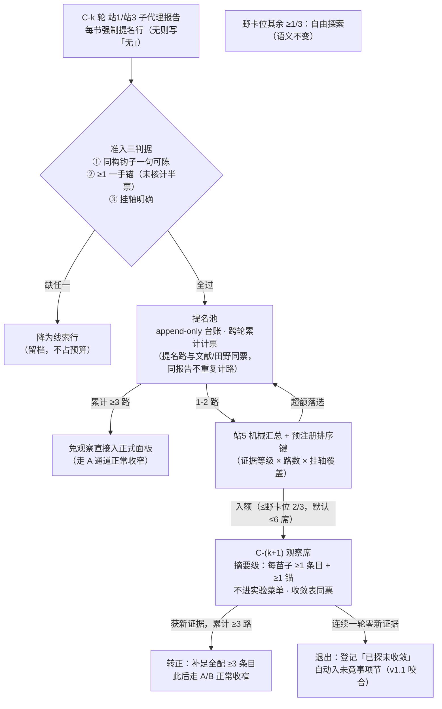

# pre-research v1.2 设计草案 · 涌现提名机制（候批，零执行）

> 状态：**已批准并实施（2026-10-02）**——三决策点按推荐执行（观察席降配 / 提名计票 / 苗子占野卡 ≤2/3）；
> 用户追加裁决 = 机制入**全部后续循环**（每轮站5 生效，非仅首轮边界）。已落地为 v1.2.0
> （SKILL §三/§四/§五/§七/§九 + methodology §1/§2/新§9）。
> 用户令（2026-10-02）：第一轮回收的子代理报告可能推荐新学科（高质量苗头），
> 强制收窄会错过；拟收集第一轮涌现的好苗子，添加到第二轮广调研的选科中。

## 〇 · 问题陈述

现行收窄公式 面板(k+1) = A×B×C 对「已涌现但未证实」的学科存在结构性盲区：

- **A 条淘汰它**：A = ≥3 路独立收敛的学科供给方——苗子通常只有 1 路（一个子代理在一次扫描中的意外发现），够不到 3 路；
- **B 条淘汰它**：B = 实验存活机制族的学科供给方——苗子从未进过实验菜单，天然不在 B；
- **C 条救不了它**：野卡位 ≥20% 虽是探索税，但技能未定义其填充来源——主代理自由裁量下，报告里的显式推荐仍可能被静默丢弃，且事后无法审计「丢过什么」。

缺口本质：**收窄公式只保留了「已证实」通道，没有给「已涌现但未证实」通道留位——收窄退化成遗忘**。

## 一 · 设计目标与不变量

- 目标：每轮（不只第一轮）子代理报告里涌现的新学科苗头被**强制收割、入池、可追踪地进入下一轮选科**；
- 不变量：
  1. 面板总规模不失控——苗子走野卡位，不改 ≥20% 下限，不新增面板层级；
  2. 实验配额不被苗子挤占——递减配额（5→3→2→1）全部留给收敛表学科；
  3. 全部提名可审计——append-only 台账，退出有理由，丢苗有记录；
  4. 机械收割——主代理对合格提名**无裁剪权**，裁剪只发生在预注册排序占位时；
  5. 与 v1.1 咬合——退出/在池未收敛苗子自动进收卷未竟事项节。

## 二 · 机制设计（五件套）

### 2.1 提名字段（收割载体，边际成本≈0）

站1/站3 子代理报告**每节末尾强制一行**：

```
提名：无
── 或 ──
提名：<学科/子域>｜同构钩子：<一句话>｜一手锚：<作者·年份·题名·出处>｜挂轴：<轴号>
```

- 必填（无提名写「无」）→ 收割是**确定性**的，不依赖主代理阅读自觉；
- 田野摸底单（十字段）增补第⑪字段「同构提名」，同格式；
- 副产品价值：非显学区（教育/质量工程/训练学等，判例：最易整片漏检）的意外提名是天然补漏信号，本通道同时服务 §三 大区审计。

### 2.2 准入三判据（提名池门槛）

① 同构钩子一句话可陈（与主选科同一标准，禁只写学科名词）；
② ≥1 一手锚（核不了标【未核】，未核提名计半票）；
③ 挂轴明确。

缺任一 → 不入池，降为报告内线索行（留档，不占任何预算）。

### 2.3 计票与直接晋升

- 合格提名计入收敛表，票种 =「**提名路**」：与文献/田野同票，田野提名带「已实装」等级（沿用现行计票规则）；**同一份报告内的多条提名不构成独立路**（防单报告灌票）；
- 累计 **≥3 路**（可跨轮累计）→ 不再是苗子：免观察席，直接按 A 通道入正式面板——它是**漏选学科**，不是苗头。

### 2.4 观察席（野卡位的降配形态）

- 站5 拟定锁定件时**机械汇总**全部合格提名，按**预注册排序键**排序：证据等级（田野实装 > 文献带锚 > 文献未核）× 提名路数 × 挂轴覆盖；
- 苗子占野卡位 **≤2/3**（其余 ≥1/3 留给与提名无关的自由探索，防提名通道反向吃掉随机探索税）；默认上限 6 席，按主题裁剪；
- 观察席**降配交付**：每苗子 ≥1 机制条目 + ≥1 一手锚（正式学科要求 ≥3），**不进实验菜单**；
- 观察席学科在收敛表**同票**，命中行标「苗子晋升」来源标签（可追溯）；
- 超额落选者**留池不丢**，下轮继续参与排序。

### 2.5 生命周期与退出

- 观察席苗子在本轮站1/站3 获新证据 → 计票累计，达 ≥3 路**转正**：补足全配 ≥3 条目，此后走 A/B 正常收窄，不再有特殊地位；
- **连续一轮零新证据 → 退出**：台账登记「已探未收敛」，并自动列入收卷未竟事项节（v1.1 咬合）；
- 台账 append-only 字段：提名轮 / 源报告 / 学科 / 钩子 / 锚 / 挂轴 / 证据等级 / 状态（在池-观察-转正-退出）/ 处置轮次与理由。

## 三 · 落点变更清单（v1.2 预览）

| 文件 | 位置 | 变更 |
|---|---|---|
| SKILL.md | §三 选学科来源 | 三条 → 四条：④上轮提名池（观察席转正/递补） |
| SKILL.md | §四 收窄公式 | C 项语义细化：≥20% 不变，填充顺序 = 提名池优先（≤2/3）+ 自由探索兜底 |
| SKILL.md | §四 新增一行 | 「涌现提名」一行（提名→池→观察席→转正/退出） |
| SKILL.md | §五 | 登记盲区升格（问题维）与涌现提名（学科维）并列为循环有机性两通道 |
| SKILL.md | §七 | 未竟事项节增列：退出/在池未收敛苗子 |
| methodology.md | §1 模板 | 机制条目节尾加提名行 |
| methodology.md | §2 | 田野摸底单加⑪同构提名 |
| methodology.md | 新 §9 | 提名池台账格式 + 排序键 + 计票细则 |

## 四 · 机制流程图



## 五 · 决策点（候裁，带推荐）

1. **观察席交付降配（≥1 条目）还是全配（≥3 条目）？** → 推荐**降配**：苗子多数不转正，全配等于在死苗上花 3 倍检索预算；转正后补足 ≥3。
2. **合格提名是否计入收敛表票？** → 推荐**计票**（带锚才计、未核半票、同报告不重复计路）：否则单路苗子永远到不了 3 路，直接晋升通道名存实亡。
3. **苗子占野卡位比例？** → 推荐 **≤2/3**：保留 1/3 无方向探索——提名本身已被主流文献视野筛过一遍，必须给真随机留位。

## 六 · 成本预估

- 提名字段：每报告一行，边际成本≈0；
- 观察席：≤6 学科 × ≥1 条目 ≈ ≤6 条目/轮（对比正式面板每轮数十条目），且退出机制保证池不跨轮累积膨胀；
- 台账与快照：站5 锁定件加一节，纯记账。

## 七 · 版本

- 本草案：plan-v1.2-涌现提名.md（2026-10-02，候批）
- 批准后执行：SKILL.md v1.1.0 → v1.2.0 + methodology.md 三处 + 公开分析仓同步
